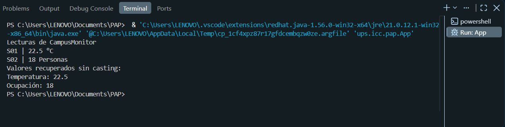

¿QUE REPRESENTA LA CLASE Lectura<T>?
La clase Lectura<T> representa una clase generica con sus atributos, su constructor y sus getters.
¿QUE REPRESENTA T Y POR QUE PERMITE UTILIZAR LA MISMA CLASE PARA LECTURA Y OCUPACION?
T es un parametro de tipo generico y permite realizar usar la misma clase tanto para lectura como para ocupacion ya que actua como comodin entre estas dos, osea que no sera necesario crear una nueva clase para uno diferente por que T adoptara el tipo de parametro que sea necesario.
¿QUE AGREGASTE EN App.java?
Instancie una clase lectura de tipo Double llamada temperatura y otra de tipo Integer llamada lectura y despues imprimi los datos que necesitava
