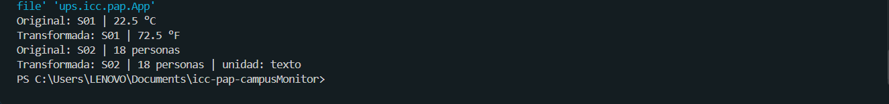

R representa el tipo de dato del valor resultante tras aplicar la funcion de conversion (por ejemplo, `Double` o `String`). El metodo transformar es generico R por que permite que una lectura de tipo T se convierta de forma flexible a cualquier tipo arbitrario segun la funcion recibida, mientras que el metodo auxiliar runTransformaciones en App es concreto y estatico por que esta diseñado especificamente para ejecutar casos de prueba definidos sin requerir parametros de tipo propios. Especificamente, en la clase Lectura se incorporo el metodo publico de instancia transformar con sus respectivas validaciones de nulos, y en la clase App se añadio el metodo privado runTransformaciones() invocado desdé el main para provar las converciones, la inmutabilidad y el manejo de exepciones, despues de que comprobamos que todas las conversiones salen correctamente probamos a camabiarle de double a report.
